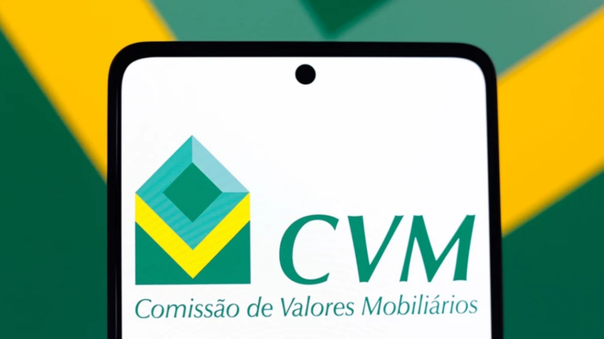

# **layouts-cvm** 

Monte, valide e serialize os arquivos que um fundo envia à CVM, nos layouts da própria CVM.

!!! note "Fonte da verdade"
    Nomes de campos, escalas decimais e cardinalidades vêm do
    [catálogo oficial de padrões XML da CVM](https://cvmweb.cvm.gov.br/SWB/Sistemas/SCW/PadroesXML/PadroesXML.asp), não desta documentação. Apenas envio:
    montar arquivos para enviar à CVM.

---

## Conteúdo { #contents }

| Seção | Descrição |
|---------|-------------|
| [Uso](usage.md) | Instalação, imports e exemplos de uso |
| [Layouts](cadastro_ativos.md) | Uma página por layout de arquivo da CVM |
| [Referência da API](api/index.md) | A interface pública e a garantia de API da 1.x |

---

## Início rápido { #quick-start }

```bash
bash bin/venv.sh   # cria o venv (o poe fica dentro dele, então o bootstrap é em shell)
poe unit_tests    # executa a suíte de testes
poe docs_serve   # serve esta documentação em http://0.0.0.0:8000
```

---

Gerado a partir do template **lib-minimal** via [BlueprintX](https://github.com/guilhermegor/BlueprintX).
