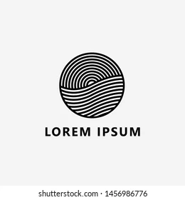

# **layouts-cvm** 

Build, validate and serialise the files a fund sends to CVM, in CVM's own file layouts.

---

## Contents

| Section | Description |
|---------|-------------|
| [Usage](usage.md) | Installation, imports, and usage examples |
| [Layouts](cadastro_ativos.md) | One page per CVM file layout (15) |
| [API Reference](api/index.md) | Module-level functions and public interface |

---

## Quick start

```bash
bash bin/venv.sh   # bootstrap the venv (poe lives inside it, so bootstrap is shell)
poe unit_tests    # run the test suite
poe docs_serve   # serve this documentation at http://0.0.0.0:8000
```

---

Generated from the **lib-minimal** template via [BlueprintX](https://github.com/guilhermegor/BlueprintX).
